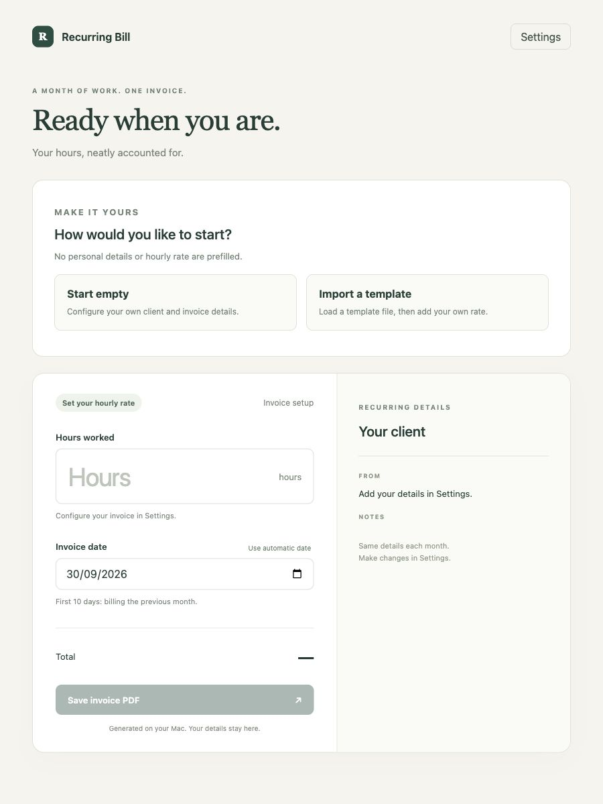

# Recurring Bill

A standalone macOS app for recurring invoices. Set up your own details once; each month enter **Hours**, check the **Date**, and save the calculated invoice as a PDF. Works offline. No account or API credentials required.

**[Download Recurring Bill for macOS — Intel + Apple Silicon](https://github.com/nvidela-dev/recurring-bill/releases/latest/download/Recurring-Bill-macOS-universal.zip)**

[All releases](https://github.com/nvidela-dev/recurring-bill/releases)

## Install and quickstart

1. Download and extract the ZIP, then move **Recurring Bill.app** into Applications.
2. Open the app and choose **Start empty** or **Import a template**.
3. Fill in your own sender details and hourly rate, check the remaining settings, and save.
4. Enter your hours, verify the date and total, and click **Save invoice PDF**.

The universal build contains Intel and Apple Silicon executables and declares macOS 11+ compatibility. It is locally ad-hoc signed, **not Apple Developer ID signed or notarized**. macOS may block a downloaded app. This is a distribution limitation of this release; no security settings are changed by the app. Developer ID signing and notarization are required for a frictionless install across coworkers' Macs.

## Empty by default, configurable throughout

Fresh installs contain **no prefilled invoice details, issuer identity, client, currency, numbering, or hourly rate**. Saving an invoice is disabled until required configuration is complete. No person's configuration or rate is bundled with the app.

Settings lets you edit:

- From (name, address, contact details) and Bill To
- Ship To / address, Notes, and Terms
- Line item label and hourly rate
- Currency and tax percentage (including 0%)
- Invoice title, number prefix, and next invoice number
- Payment terms

Settings persist locally. The normal monthly screen stays focused on hours, an editable date, and the calculated total. Amount is hours × your configured rate; any configured tax is shown separately before the total. Hours and rate accept up to two decimal places. Money calculations use integer arithmetic and round half up to the currency's smallest unit. This version supports currencies with two decimal places, including USD, EUR, GBP, UYU, BRL, CAD, and AUD. Currency conversion is not performed.

A successful native PDF save advances the invoice number; cancelling or a failed write does not. To re-export an invoice, set its number in Settings first. Saved PDFs are your records; there is no invoice history service or invoice sending feature.



## Private templates

The app includes no client templates, company details, or rates. Template files are shared separately by you or your team; they are not uploaded to this repository or bundled in releases.

Choose **Import a template** on the first-run screen, or **Import template** in Settings. Accepts plain `.txt` files containing JSON and `.json` files. Files stay on your Mac; the app reads them locally. Imported templates always clear the hourly rate so each person enters their own. A template changes the editable form; saved settings change only after **Save settings**.

Format: a JSON object with `version: 1` and a `settings` object. Include every key below, using strings (empty strings for unspecified values):

```json
{
  "version": 1,
  "settings": {
    "from": "",
    "billTo": "",
    "shipTo": "",
    "notes": "",
    "itemLabel": "",
    "hourlyRate": "",
    "currency": "",
    "taxPercent": "",
    "invoiceTitle": "",
    "numberPrefix": "",
    "nextNumber": "",
    "paymentTerms": "",
    "terms": ""
  }
}
```

Do not commit real client templates, saved settings, invoices, or private hourly rates to this repository. Keep shared template files in your team's chosen private channel.

## Date behavior

Uses the Mac's local calendar/time zone. Dates are not converted through UTC:

- Days 1–10 inclusive → the last calendar day of the previous month.
- The last 10 days inclusive → the last calendar day of the current month (22–31 in a 31-day month).
- Other days → no silent choice: pick Previous month, This month, or enter a date.

The user can always enter a valid date from 2000–2199. **Use automatic date** reapplies the rule. Defaults run on launch or a button press, not while you're editing a draft at midnight. Leap years, 28/29/30/31-day months, and January rollover are covered by tests.

## Local data and privacy

The shared app uses `com.nvideladev.recurringbill`, a separate app identity from the original personal prototype. It does not migrate or read the prototype's data.

Configuration is stored locally at:

`~/Library/Application Support/com.nvideladev.recurringbill/settings.json`

This is ordinary local JSON, not an encrypted vault. The rate is stored only in the user's own configuration. Settings are written through a temporary file and rename. Invalid/unreadable saved configuration blocks generation instead of silently replacing it. Back up that file and your exported PDFs.

Native PDFs are written to a temporary file in the selected directory, flushed, and then renamed into place. A single-instance guard prevents two app windows racing the saved number. PDFs are generated entirely on-device with jsPDF; no invoice information is sent to invoice-generator.com or any other service. The packaged frontend's content security policy blocks outgoing network connections.

The PDF font supports common Western Latin text. Arbitrary writing systems require a future embedded font. Excessively long address blocks are rejected rather than clipped; Notes and Terms flow to additional pages.

## Development

Requires Node.js 22.12+ or a supported newer release, npm, Rust stable, and Xcode Command Line Tools. See [Tauri prerequisites](https://v2.tauri.app/start/prerequisites/).

```sh
xcode-select --install
# Install Rust from https://rustup.rs if cargo is not available.
git clone git@github.com:nvidela-dev/recurring-bill.git
cd recurring-bill
npm ci
npm test
npm run desktop:dev
```

Frontend preview: `npm run dev`, then open http://127.0.0.1:1430. Browser preview stores separate localStorage; it neither reads nor writes the native app's configuration. Browser downloads advance numbers when download is initiated, since browsers cannot confirm whether a user retained the file. Use the native app for the normal invoice workflow.

## Build and share

Current Mac architecture:

```sh
npm run desktop:build
```

Output: `src-tauri/target/release/bundle/macos/Recurring Bill.app`.

Universal macOS app and shareable ZIP:

```sh
rustup target add aarch64-apple-darwin x86_64-apple-darwin
npm run desktop:universal
npm run package:macos
```

Output app: `src-tauri/target/universal-apple-darwin/release/bundle/macos/Recurring Bill.app`.

Share `release/Recurring-Bill-macOS-universal.zip`; `release/SHA256SUMS.txt` provides its checksum. The scripts apply and verify a local signature, check both CPU architectures, preserve bundle symlinks, and exclude extended filesystem metadata from the archive. Generated apps, invoices, dependencies, and user configuration are excluded from Git.

## Release updates

Bump `package.json`, `src-tauri/Cargo.toml`, and `src-tauri/tauri.conf.json` together. Commit/push the source, create a version tag such as `v1.2.0`, and push the tag. Then run the **Build macOS release** workflow in GitHub Actions with that existing tag, or:

```sh
gh workflow run release.yml -f tag=v1.2.0
```

The workflow tests and builds that exact tagged source and publishes the universal ZIP and checksum as release assets. It uses GitHub's built-in token; no extra secrets are required for the current ad-hoc builds. Apple signing/notarization would require your team's Apple developer credentials in GitHub secrets and changes to the signing script. This version has no automatic updater; coworkers download newer releases from the link above.

## How the code fits together

- `src/domain.ts`: blank defaults, template import validation, date rules, and exact money arithmetic.
- `src/main.ts`: first-run choices, settings, hours/date workflow, and save result handling.
- `src/pdf.ts`: local PDF layout using user configuration.
- `src/storage.ts`: native/browser configuration and PDF save adapters.
- `src-tauri/src/main.rs`: single-instance behavior, app-data storage, and native file-save dialog.

Invoice rules are independent of the screen and the native Mac bridge, so changing the UI does not change billing arithmetic. See [verification notes](docs/verification.md) for the delivered checks and remaining limitations.
